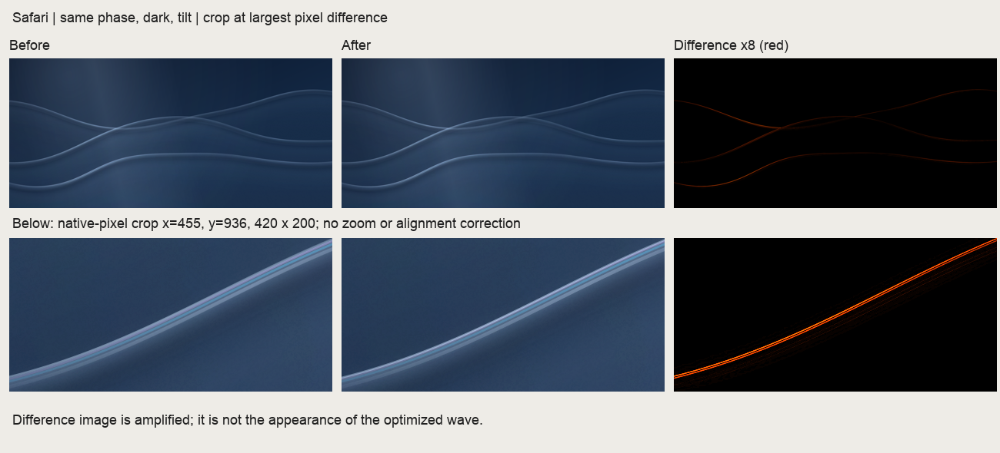
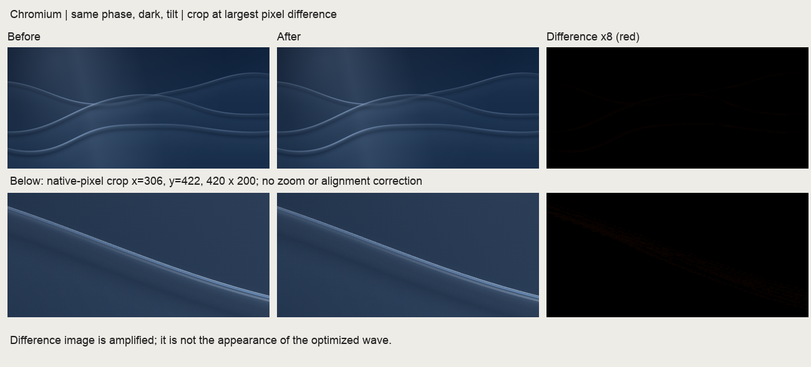

# Lab 波浪：Safari 光晕成本与画面取舍

日期：2026-10-15（AEDT）。修复前基线：`a0e0b62`。本轮包含波浪性能修复，不含重新设计。准确的源码 SHA-256 见 [provenance.json](assets/lab-wave-performance-2026-10-15/provenance.json)。

## 实现

- 把两处边缘光晕的 `shadowBlur` 从主 Canvas 移至 CSS 尺寸一半的透明缓冲区。通过移出画布的源描边只生成阴影，再合成回主画布；清晰描边、彩边、波形与配色仍按原分辨率绘制。缓冲区随画质缩小，不能建立缓冲时保留原路径，dispose 时释放。
- 调度使用累加的绘制期限，保留显示帧之间的余量；延误时跳过过期的期限，不突发补绘。解决约 100Hz 的 rAF 节奏下，30/60 上限被取整为 25/50 的问题。
- 降级同时检查同步绘制耗时和实际绘制间隔，相对 30/60 的当前目标判断持续压力。一次停顿不会立即降级；切换目标、暂停和可见性变化会重置采样。增加 `data-frame-ms`，与 `data-render-ms` 分开表达。
- 为波浪模块及加载它的 `lab.js` 添加内容版本号，避免已观察到的 CDN 旧文件缓存。

## 性能：单独采样，不截图

同一台机器，macOS 15.8，原生 Safari 27.0 和有窗口的 Brave/Chromium 155。视口 1920×1003 CSS px，设备 DPR 2，波浪实际 backing 为 2880×1337，深色主题。预热 3.5 秒，静置 8 秒，使用固定正弦轨迹、50ms 一次的合成 pointermove 采样 10 秒，再暂停 4 秒。各阶段均保持前台、焦点和可见性，没有隐藏样本。

| 浏览器 | 静置：前 → 后（次/秒） | 交互：前 → 后（次/秒） | 交互绘制间隔 P95：前 → 后 |
| --- | ---: | ---: | ---: |
| Safari / WebKit | 28.2 → 30.0 | 25.2 → 36.3 | 45 → 31ms |
| Chromium | 25.0 → 30.0 | 49.9 → 59.9 | 20.9 → 20.2ms |

两侧、前后均保持 `quality=full`，因此性能提升没有混入自动降级的分辨率变化。暂停阶段都没有波浪绘制。Safari 仍未达到 60 次/秒；不能把它写成已完全消除卡顿。

Safari 优化后首次采样为 35.8 次/秒，最终源码复测为 36.3 次/秒；表格使用后者。

这里记录的是波浪绘制调用次数和主线程帧调度，不是屏幕最终呈现 FPS、GPU 耗时或输入到显示的延迟。同步 paint P95 仍约 2ms，不能用它替代整个渲染管线成本。Safari 缺少 Canvas 2D `filter`，原实现使用多次采样的透射回退；Chromium 使用 filter，跨引擎不是完全相同的渲染路径。前后比较分别在同一个引擎内进行。

修复使实际绘制更接近预定频率，不能据此宣称功耗下降；本轮没有测功耗。新增的 glow 缓冲在这个尺寸约占 1.6MiB RGBA 像素存储，不含浏览器其他 backing 开销。

原始数据：[Safari 前](assets/lab-wave-performance-2026-10-15/safari-before.json)、[Safari 后](assets/lab-wave-performance-2026-10-15/safari-after.json)、[Chromium 前](assets/lab-wave-performance-2026-10-15/chromium-before.json)、[Chromium 后](assets/lab-wave-performance-2026-10-15/chromium-after.json)。

## 画面：固定输入导出，独立于性能采样

两个引擎各导出修复前后 10 组 PNG：桌面亮暗主题的相位 0、35、倾斜状态；手机亮暗；soft 画质亮暗。宽高、DPR、time、theme、tilt、spread、lift、quality 和纹理种子严格匹配，不做对齐、模糊或颜色补偿。比对同引擎的前后图片，不把 Safari 与 Chromium 原有差异算作回归。

指标：全分辨率 RGB MAE / RMSE / 最大通道差阈值占比；灰度 SSIM 使用 7×7 均值窗口，图像宽度最多缩到 960；另用原图灰度相邻像素差 >2 构建边缘掩模，并膨胀 11×11，单独统计边缘 RGB MAE，避免大面积天空稀释边缘变化。

| 最差结果（各 10 场景） | Chromium | Safari / WebKit |
| --- | ---: | ---: |
| 全图平均绝对通道差（0–255） | 0.0216 | 0.1369 |
| 最低 SSIM（上述 960px 方法） | 0.99987 | 0.99907 |
| 最大通道差 >8 的像素占比 | 0.0085% | 0.4919% |
| 边缘掩模内平均通道差（0–255） | 0.0554 | 0.4593 |

结论：差异集中在细光晕的分布和局部亮度，波形几何与主体配色没有被改变。整体变化小，但不等于逐像素一致：Safari 最差倾斜暗色场景的单点最大通道差为 76/255，差 >16 的像素占比为 0.2301%。原尺寸局部裁图比全图 SSIM 更能看清这个取舍。没有把这种固定图像比较当作 Safari 实时 backdrop 残留的证明——此前已确认截图会刷新该合成结果。

红色差异列放大了 8 倍，不代表真实显示强度。下排为包含最大差异点的原尺寸裁图。完整逐场景数值见 [visual-metrics.json](assets/lab-wave-performance-2026-10-15/visual-metrics.json)。完整 PNG 与一次性原生浏览器采样、导出及差异计算工具保存在本机 `/private/tmp/lab-wave-comparison/`，没有把约百 MB 的一次性图像加入仓库。

差异计算工具也保留为 `scripts/compare-wave-images.py`（Pillow、NumPy 是可选 QA 依赖，不是站点依赖）。将同引擎、同场景图片命名为 `safari-before-CASE.png` / `safari-after-CASE.png`，或使用 `chromium` 前缀，然后运行 `python3 scripts/compare-wave-images.py /path/to/exports`，会生成 JSON 指标及 8 倍差异图。

## 检查

- `node scripts/check-wave-timing.cjs`：60/100/120Hz 环境与交互目标；暂停、隐藏恢复、dispose；廉价同步 paint 但长期低帧时降级；极慢帧；单次长停顿不误降级。
- `scripts/check-lab.cjs`：真实 Chromium 的倾斜、回正、卡片响应、暂停恢复、主题、各宽度溢出、离屏、reduced motion、context loss、无 JS、无 Canvas／storage 回退通过。
- `node --check lab/wave-scene.js`、`git diff --check` 通过。

未重新生成 poster：同相位比较表明主体与几何保持一致，改动集中在细小光晕；静态回退继续使用已有 poster。
